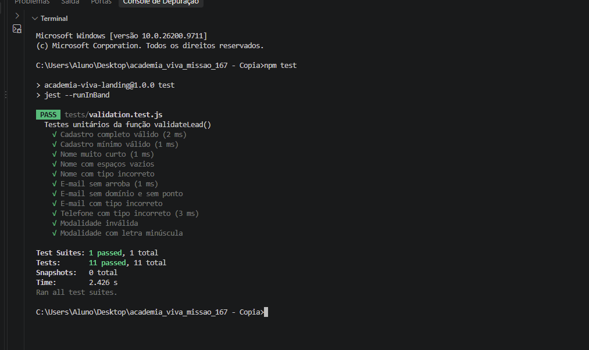

# RELATÓRIO DE TESTES DE SOFTWARE

## 1\. Identificação do projeto

| Informação | Descrição |
| --- | --- |
| **Nome do projeto:** | \[Academia_viva_missão_167] |
| **Resumo do projeto:** | \[Aplicação web para cadastro de interessados em cursos, com validação das informações preenchidas pelos usuários.\]
| **Nome do testador:** | \[Gabrielly Vitória\] |
| **Data dos testes:** | \[04/11/26\] |
| **Tecnologias utilizadas:** | \[JavaScript, Node.js, Jest\] |

---

## 2\. Objetivo dos testes

Descreva qual foi o objetivo da realização dos testes na aplicação.

-  Qual funcionalidade foi testada?
-  O que os testes pretendiam verificar?
-  Quais possíveis erros ou falhas deveriam ser identificados?

**Resposta:**

\[
O objetivo dos testes foi verificar se a função validateLead() está validando corretamente as informações do formulário de cadastro. Buscamos identificar possíveis erros, como nomes inválidos, e-mails incorretos, tipos de dados errados e modalidades não permitidas, garantindo que o sistema funcione como esperado e aceite apenas informações válidas.\]

---

## 3\. Ambiente de testes

Informe as ferramentas e tecnologias utilizadas para executar os testes.

| Ferramenta/Tecnologia | Versão |
| --- | --- |
| JavaScript | \[22.0.1\] |
| Node.js | \[v22.2.0] |
| Jest | \[30.5.2\] |
| NPM | \[10.7.0\] |
| Outras | \[Não \] |

**Comando utilizado preparar o ambiente:**

``` bash
[npm install]
```

**Comando utilizado executar o sistema (servidor):**

``` bash
[npm start]
```

**Comando utilizado para executar os testes:**

``` bash
[npm test ]
```

---

## 4\. Funcionalidades testadas

Liste as funções, métodos ou componentes da aplicação que foram submetidos aos testes.

| Nº | Funcionalidade/Função | Arquivo | Objetivo do teste |
| --- | --- | --- | --- |
| 1 | \[validateLead()\] | \[validation.js\] | \[	Verificar se o cadastro completo é aceito.\] |
| 2 | \[validateLead()\] | \[validation.js\] | \[Verificar se o cadastro mínimo é aceito.\] |
| 3 | \[validateLead()\] | \[validation.js\] | \[ Identificar nomes com menos de 3 caracteres.\] |
| 4| \[validateLead()\] | \[validation.js\]  | \[	Identificar nomes preenchidos apenas com espaços.\] |
| 5 | \[validateLead()\] | \[validation.js\] | \[Identificar nomes com tipo diferente de string.\] |
| 6 | \[validateLead()\] | \[validation.js\] | \[dentificar e-mails sem o símbolo @.\] |
| 7 | \[validateLead()\] | \[validation.js\] | \[Identificar e-mails incompletos.\] |
| 8 | \[validateLead()\] | \[validation.js\] | \[dentificar e-mails com tipo incorreto.\] |
| 9 | \[validateLead()\] | \[validation.js\] | \[Verificar se o telefone foi informado como texto.\] |
| 10 | \[validateLead()\]| \[validation.js\] | \[Identificar modalidades não permitidas.\] |
| 11| \[validateLead()\] | \[validation.js\] | \[Verificar a diferença entre letras maiúsculas e minúsculas na modalidade.\] |
---
---

## 5\. Registro detalhado dos testes realizados

Registre individualmente TODOS os testes implementados.

Para cada teste, preencha as informações abaixo.


### Teste 01 – \[Cadastro completo válido\]

- **Funcionalidade testada:** \[Função validateLead().\]
- **Nome do teste no Jest:** \[ Cadastro completo válido.\]
- **Objetivo:** \[ Verificar se o cadastro é aceito quando todos os campos são preenchidos corretamente.\]
- **Tipo de cenário:**\[  Positivo..\]
- **Entrada utilizada:** \[: Nome: "João Silva" e e-mail: "joao@email.com".\]
- **Resultado esperado:** \[ Cadastro validado sem erros.\]
- **Resultado obtido:** \[Cadastro validado corretamente.\]
- **Status:** \[Aprovado \]

**Código do teste:**

``` javascript

test("Cadastro completo válido", () => {
    const result = validateLead({
        name: "João Silva",
        email: "joao@email.com"
    });

    expect(result.valid).toBe(true);
});.
```

---


### Teste 02– \[Cadastro mínimo válido\]

- **Funcionalidade testada:** \[Função validateLead().\]
- **Nome do teste no Jest:** \[ Cadastro mínimo válido.]
- **Objetivo:** \[Verificar se o sistema aceita o cadastro preenchendo somente os campos obrigatórios.\]
- **Entrada utilizada:** \[João Silva" e e-mail: "joao@email.com".\]
- **Resultado esperado:** \[: Cadastro aceito sem erros, mesmo sem preencher os campos opcionais.\]
- **Resultado obtido:** \[Cadastro aceito corretamente.\]
- **Status:** \[Aprovado\]

**Código do teste:**

``` javascript

test("Cadastro mínimo válido", () => {
    const result = validateLead({
        name: "João Silva",
        email: "joao@email.com"
    });

    expect(result.errors.length).toBe(0);
    expect(result.valid).toBe(true);
});

```


### Teste 03– \[Nome muito curto\]

- **Funcionalidade testada:** \[Validação do campo nome na função validateLead().\]
- **Nome do teste no Jest:** \[Nome muito curto.\]
- **Objetivo:** \[Verificar se o sistema identifica quando o nome possui poucos caracteres.\]
- **Entrada utilizada:** \["Jo" e e-mail: "email@email.com".\]
- **Resultado esperado:** \[O sistema deve apresentar uma mensagem informando que o nome precisa ter no mínimo 2 caracteres\]
- **Resultado obtido:** \[O sistema identificou o nome curto e apresentou a mensagem de erro.\]
- **Status:** \[Aprovado\]

**Código do teste:**

``` javascript

test("Nome muito curto", () => {
    const result = validateLead({
        name: "Jo",
        email: "email@email.com"
    });

    expect(result.errors).toContain(
        "Informe seu nome (mínimo de 2 caracteres)."
    );
});

```


### Teste 04– \[N Nome com espaços vazios\]

- **Funcionalidade testada:** \[Validação do campo nome na função validateLead().\]
- **Nome do teste no Jest:** \[Nome com espaços vazios\]
- **Objetivo:** \[ Verificar se o sistema identifica quando o usuário \]
- **Entrada utilizada:** \[Nome: "       " e e-mail: "email@email.com".\]
- **Resultado esperado:** \[O sistema deve informar que o nome foi preenchido incorretamente.\]
- **Resultado obtido:** \[ O sistema identificou que o campo não possui um nome válido e apresentou a mensagem de erro.\]
- **Status:** \[Aprovado\]

**Código do teste:**

``` javascript

test("Nome com espaços vazios", () => {
    const result = validateLead({
        name: "       ",
        email: "email@email.com"
    });

    expect(result.errors).toContain(
        "Informe seu nome (mínimo de 2 caracteres)."
    );
});
```


### Teste 5– \[Nome com tipo incorreto\]

- **Funcionalidade testada:** \[Validação do tipo de dado do campo nome.\]
- **Nome do teste no Jest:** \[ Nome com tipo incorreto.\]
- **Objetivo:** \[Verificar se o sistema identifica quando é informado um número no lugar de um texto.\]
- **Entrada utilizada:** \[Nome: 123 e e-mail: "email@email.com".\]
- **Resultado esperado:** \[ O sistema deve apresentar uma mensagem informando que o nome é inválido.\]
- **Resultado obtido:** \[sistema identificou o tipo de dado incorreto e apresentou a mensagem de erro.\]
- **Status:** \[Aprovado\]

**Código do teste:**

``` javascript

test("Nome com tipo incorreto", () => {
    const result = validateLead({
        name: 123,
        email: "email@email.com"
    });

    expect(result.errors).toContain(
        "Informe seu nome (mínimo de 2 caracteres)."
    );
});

```


### Teste 06– \[E-mail sem arroba\]

- **Funcionalidade testada:** \[Validação do campo e-mail na função validateLead().\]
- **Nome do teste no Jest:** \[E-mail sem arroba.\]
- **Objetivo:** \[Verificar se o sistema identifica um endereço de e-mail sem o símbolo @.\]
- **Entrada utilizada:** \["Ana Silva" e e-mail: "anaemail.com".\]
- **Resultado esperado:** \[O sistema deve informar que o endereço de e-mail é inválido.\]
- **Resultado obtido:** \[: O sistema identificou a falta do símbolo @ e apresentou a mensagem de erro.\]
- **Status:** \[Aprovado\]

**Código do teste:**

``` javascript

test("E-mail sem arroba", () => {
    const result = validateLead({
        name: "Ana Silva",
        email: "anaemail.com"
    });

    expect(result.errors).toContain(
        "Informe um e-mail válido."
    );
});

```


### Teste 07– \[ E-mail incompleto\]

- **Funcionalidade testada:** \[Validação do campo e-mail na função validateLead().\]
- **Nome do teste no Jest:** \[E-mail sem domínio e sem ponto.\]
- **Objetivo:** \[Verificar se o sistema identifica um e-mail incompleto, sem a parte final do domínio.\]
- **Entrada utilizada:** \[Nome: "Ana Silva" e e-mail: "email@email".\]
- **Resultado esperado:** \[O sistema deve apresentar uma mensagem informando que o e-mail é inválido.\]
- **Resultado obtido:** \[O sistema identificou que o e-mail está incompleto e apresentou a mensagem de erro.\]
- **Status:** \[Aprovado\]

**Código do teste:**

``` javascript

test("E-mail sem domínio e sem ponto", () => {
    const result = validateLead({
        name: "Ana Silva",
        email: "email@email"
    });

    expect(result.errors).toContain(
        "Informe um e-mail válido."
    );
});

```


### Teste 08– \[E-mail com tipo incorreto\]

- **Funcionalidade testada:** \[Validação do tipo de dado do campo e-mail.\]
- **Nome do teste no Jest:** \[E-mail com tipo incorreto\]
- **Objetivo:** \[: Verificar se o sistema identifica quando um número é informado no lugar de um endereço de e-mail. \]
- **Entrada utilizada:** \[ Nome: "Ana Silva" e e-mE-mail com tipo incorreto 123.\]
- **Resultado esperado:** \[O sistema deve informar que o e-mail é inválido.\]
- **Resultado obtido:** \[O sistema identificou o tipo de dado incorreto e apresentou a mensagem de erro.\]
- **Status:** \[Aprovado\]

**Código do teste:**

``` javascript

test("E-mail com tipo incorreto", () => {
    const result = validateLead({
        name: "Ana Silva",
        email: 123
    });

    expect(result.errors).toContain(
        "Informe um e-mail válido."
    );
});

```


### Teste 09– \[ Telefone com tipo incorreto\]

- **Funcionalidade testada:** \[Validação do tipo de dado do campo telefone.\]
- **Nome do teste no Jest:** \[Telefone com tipo incorreto.\]
- **Objetivo:** \[Verificar se o sistema identifica quando o telefone é informado como número em vez de texto.\]
- **Entrada utilizada:** \[Ana Silva", e-mail: "ana@email.com" e telefone: 2796542378.\]
- **Resultado esperado:** \[O sistema deve informar que o telefone precisa ser um texto.\]
- **Resultado obtido:** \[ O sistema identificou o tipo de dado incorreto e apresentou a mensagem de erro. \]
- **Status:** \[Aprovado\]

**Código do teste:**

``` javascript

test("Telefone com tipo incorreto", () => {
    const result = validateLead({
        name: "Ana Silva",
        email: "ana@email.com",
        phone: 2796542378
    });

    expect(result.errors).toContain(
        "O telefone deve ser um texto."
    );
});

```


### Teste 10– \[ Modalidade inválida\]

- **Funcionalidade testada:** \[Validação do campo interesse na função validateLead().\]
- **Nome do teste no Jest:** \[ Modalidade inválida.\]
- **Objetivo:** \[Verificar se o sistema identifica quando o usuário escolhe uma modalidade que não está entre as opções permitidas.\]
- **Entrada utilizada:** \[Nome: "Ana Silva", e-mail: "ana@email.com" e interesse: "Semipresencial".\]
- **Resultado esperado:** \[O sistema deve informar que a modalidade selecionada é inválida.\]
- **Resultado obtido:** \[O sistema identificou a modalidade não permitida e apresentou a mensagem de erro.\]
- **Status:** \[Aprovado\]

**Código do teste:**

``` javascript

test("Modalidade inválida", () => {
    const result = validateLead({
        name: "Ana Silva",
        email: "ana@email.com",
        interest: "Semipresencial"
    });

    expect(result.errors).toContain(
        "Selecione uma modalidade válida."
    );
});
```


### Teste 11– \[Modalidade com letra minúscula\]

- **Funcionalidade testada:** \[Validação do campo interesse na função validateLead().\]
- **Nome do teste no Jest:** \[Modalidade com letra minúscula.\]
- **Objetivo:** \[ Verificar se o sistema diferencia letras maiúsculas e minúsculas na modalidade selecionada.\]
- **Entrada utilizada:** \[Nome: "Ana Silva", e-mail: "ana@email.com" e interesse: "online".\]
- **Resultado esperado:** \[ O sistema deve informar que a modalidade é inválida, pois a opção cadastrada utiliza a letra inicial maiúscula.\]
- **Resultado obtido:** \[O sistema identificou a diferença entre as letras e apresentou a mensagem de erro.\]
- **Status:** \[Aprovado\]

**Código do teste:**

``` javascript

test("Modalidade com letra minúscula", () => {
    const result = validateLead({
        name: "Ana Silva",
        email: "ana@email.com",
        interest: "online"
    });

    expect(result.errors).toContain(
        "Selecione uma modalidade válida."
    );
});

```


> **Importante:** Duplique o bloco de registro acima para documentar todos os testes realizados. Não registre apenas os testes aprovados. Os testes reprovados também devem ser documentados.

---

## 6\. Resumo dos resultados

Apresente um resumo quantitativo de todos os testes executados.

| Indicador | Quantidade |
| --- | ---: |
| Total de testes executados | \[11\] |
| Testes aprovados (Passed) | \[11\] |
| Testes reprovados (Failed) | \[0\] |

**Percentual de aprovação:**

\[Calcule: (Testes aprovados ÷ Total de testes executados) × 100\]


## 6\. Resumo dos resultados

Apresente um resumo quantitativo de todos os testes executados.

| Indicador | Quantidade |
| --- | ---: |
| Total de testes executados | \[Número\] |
| Testes aprovados (Passed) | \[Número\] |
| Testes reprovados (Failed) | \[Número\] |

**Percentual de aprovação:**

\[Calcule: (Testes aprovados ÷ Total de testes executados) × 100\]

(11 ÷ 11) × 100 = 100%
---
---

## 7\. Evidências da execução dos testes

Insira capturas de tela (prints) que comprovem a execução dos testes no ambiente de desenvolvimento.

]

Inclua evidências que mostrem:

- Execução dos testes no Jest. 11
- Quantidade de testes aprovados e reprovados. Aprovados
- Mensagens de erro, quando houver. 0
- Correções realizadas após a identificação de falhas, se aplicável. Não houve

---

## 8\. Problemas identificados e correções realizadas

Registre os problemas encontrados durante a execução dos testes e as soluções implementadas.

| Problema identificado | Causa do problema | Solução implementada | Situação |
| --- | --- | --- | --- |
| \[Descreva o erro\] | \[Possível causa\] | \[Correção realizada\] | \[Resolvido/Pendente\] |
| \[Descreva o erro\] | \[Possível causa\] | \[Correção realizada\] | \[Resolvido/Pendente\] 
| \[Descreva o erro\] | \[Possível causa\] | \[Correção realizada\] | \[Resolvido/Pendente\] 

Caso nenhum problema tenha sido identificado, explique.

**Resposta:**

\[Nenhum problema foi identificado durante a execução dos testes. A função apresentou o comportamento esperado nos cenários testados, aceitando os dados válidos e apresentando mensagens de erro para os dados inválidos. Por isso, não foram necessárias correções no código.\]

---

## 9\. Análise dos resultados

Responda às questões:

1. Todos os testes apresentaram os resultados esperados? Justifique.

2. Quais foram os cenários mais importantes verificados durante os testes?
3. Algum teste identificou uma falha na aplicação? Qual?
4. Quais alterações foram necessárias para corrigir os problemas encontrados?
5. Existem funcionalidades que ainda precisam ser testadas? Quais?

**Respostas:**

\[1.Sim, todos os testes apresentaram os resultados esperados, pois os cadastros válidos foram aceitos e os dados inválidos foram identificados corretamente.

2.Os cenários mais importantes foram o cadastro completo, o cadastro mínimo e as validações de nome, e-mail, telefone e modalidade.

3.Não. Nenhum teste identificou falhas na aplicação durante a execução.

4.Não foram necessárias alterações ou correções, pois a função apresentou o comportamento esperado em todos os testes.

5.Sim. Ainda podem ser testados outros cenários, como caracteres especiais no nome, espaços no e-mail e diferentes formatos de telefone.

\]

---

## 10\. Conclusão

Apresente uma conclusão sobre o processo de testes realizado.

- Os testes contribuíram para identificar possíveis falhas?
- A aplicação apresentou o comportamento esperado nos cenários testados?
- Qual foi a importância dos testes unitários para a qualidade do software desenvolvido?

**Conclusão da equipe:**

\[Os testes unitários foram importantes para verificar se a função estava funcionando corretamente. Durante a execução, os 11 testes apresentaram os resultados esperados, sem identificar problemas. Isso mostrou que a aplicação conseguiu aceitar os dados válidos e rejeitar os inválidos. Os testes também foram importantes para aumentar a confiança no código e ajudar a garantir a qualidade do software.\]

---

**Relatório elaborado por:** \[Gabriellly Vitória\]

**Data da última atualização:** \[16/11/2026\]